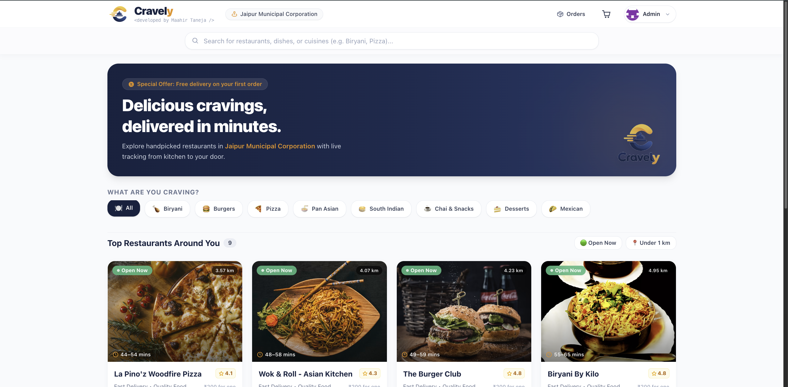
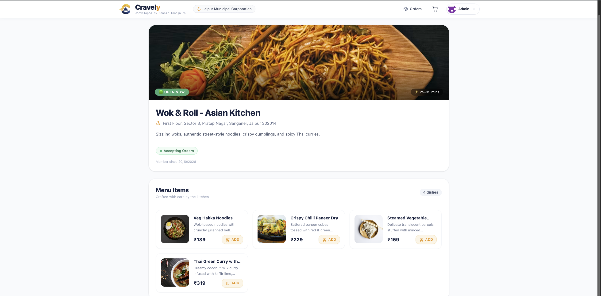
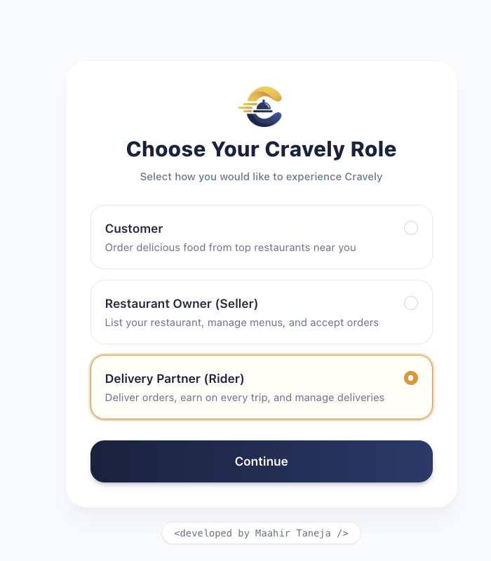
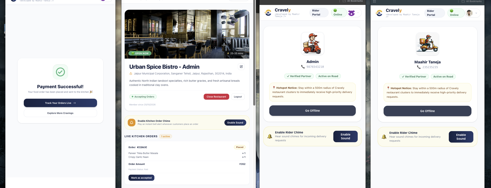
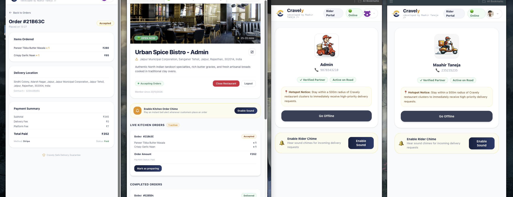
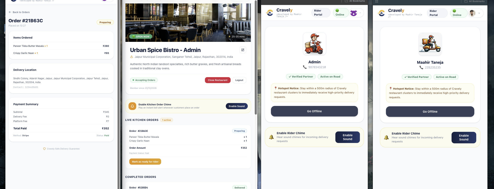
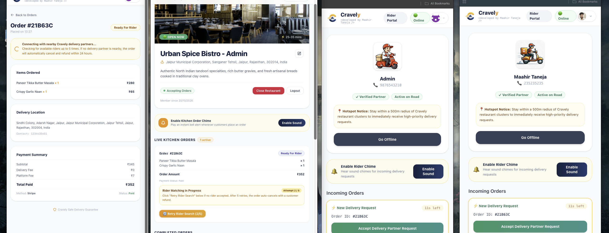
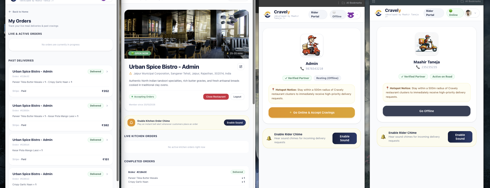
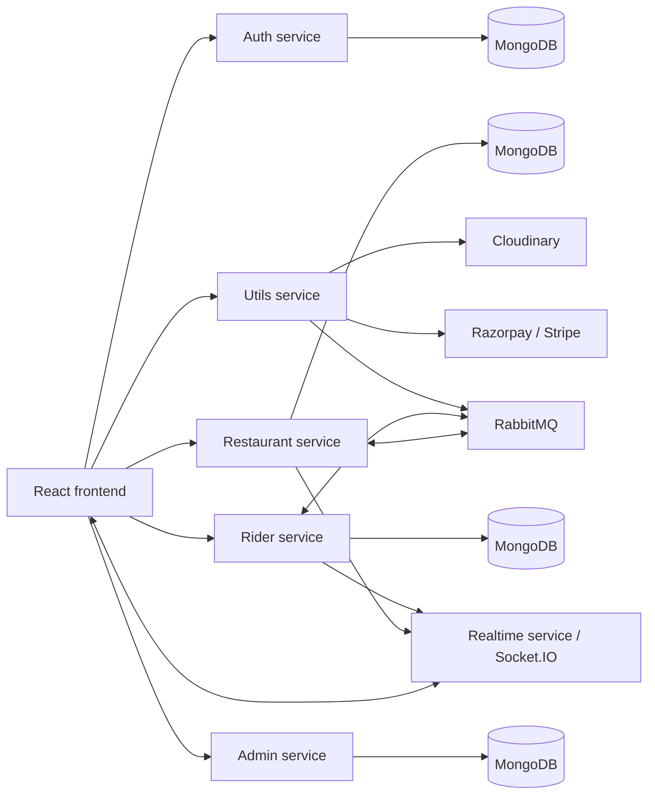

# Cravely

Cravely is a food ordering and delivery platform with separate experiences for customers, restaurant sellers, riders, and administrators. Customers can find restaurants, browse menus, manage a cart and delivery address, place and pay for orders, and follow order progress. Restaurants manage their listings and incoming orders, while riders receive delivery requests and update delivery status.

## 📸 Screenshots

The screenshots below show the customer experience and the same order progressing across a customer window, restaurant seller window, and two rider windows. Browser address bars and desktop chrome have been cropped from the captures.

### Customer experience

| Restaurant discovery | Restaurant menu | Role selection | Payment success |
| --- | --- | --- | --- |
|  |  |  |  |

### Multi-window order flow

Each capture shows the customer, restaurant, and two rider windows together as the order moves through the workflow.

| Order accepted | Restaurant preparing the order |
| --- | --- |
|  |  |

| Rider matching | Order history across the customer, restaurant, and rider windows |
| --- | --- |
|  |  |

## ✨ Features

### Customer ordering

- Browse restaurants and menu items, with location-aware restaurant discovery.
- View restaurant details and add menu items to a persistent cart.
- Save delivery addresses, review checkout, and complete payment.
- View order history, order details, and order status updates.
- Sign in with Google and choose an account role.

### Restaurant seller

- Create and manage restaurant profiles and menu items.
- View incoming orders and progress them through preparation and handoff.
- Upload restaurant and menu images through Cloudinary.

### Rider delivery

- Rider dashboard for available delivery requests and current deliveries.
- Accept an order, update delivery status, and view map-based order information.
- Receive order-ready events through RabbitMQ and real-time updates through Socket.IO.

### Administration

- Admin dashboard for managing restaurants and rider accounts.
- Admin access is protected by the backend authentication middleware.

### Payments and live updates

- Payment service supports Razorpay and Stripe integrations.
- RabbitMQ carries payment and order-ready events between services.
- Socket.IO delivers order events to connected users.

## 🧩 Application services

| Service | Default port | Responsibility |
| --- | ---: | --- |
| Frontend | 5173 | React application and customer, seller, rider, and admin interfaces. |
| Restaurant | 5001 | Restaurants, menu items, carts, addresses, and orders. |
| Utils | 5002 | Cloudinary uploads and payment endpoints. |
| Realtime | 5004 | Socket.IO connections and internal event broadcasting. |
| Rider | 5005 | Rider profiles and delivery workflow. |
| Admin | 5006 | Administrative APIs. |
| Auth | 5007 | Google sign-in, user profiles, role selection, and JWT issuance. |

## How an order flows

1. A customer selects a restaurant and menu items; the frontend calls the restaurant service for menu and cart operations.
2. The customer provides an address and starts checkout. The utils service creates or verifies a payment.
3. Payment events are sent over RabbitMQ and consumed by the restaurant service, which updates the order.
4. The restaurant marks the order ready. RabbitMQ notifies the rider service, and Socket.IO broadcasts relevant status updates.
5. The rider accepts and completes delivery, with rider and restaurant services coordinating through internal API calls.



## 🛠️ Technology stack

| Area | Technologies |
| --- | --- |
| Frontend | React 19, TypeScript, Vite, Tailwind CSS 4, React Router, Axios |
| Maps and location | Leaflet, React Leaflet, OpenStreetMap Nominatim reverse geocoding, browser geolocation |
| Live communication | Socket.IO client and server |
| Backend | Node.js, TypeScript, Express 5 microservices |
| Database | MongoDB and Mongoose; MongoDB native driver in the admin service |
| Authentication | Google OAuth, JWT |
| File uploads | Multer and Cloudinary |
| Payments | Razorpay and Stripe |
| Messaging | RabbitMQ via amqplib |

## 📁 Project structure

```text
Cravely/
├── frontend/
│   ├── src/components/       # Shared navigation, restaurant, order, and rider UI
│   ├── src/context/          # App state and Socket.IO context
│   ├── src/pages/            # Customer, seller, rider, and admin pages
│   └── src/utils/            # Frontend workflow helpers
├── services/
│   ├── auth/                 # Login, registration, profiles, and roles
│   ├── restaurant/           # Restaurants, menus, carts, addresses, and orders
│   ├── rider/                # Rider and delivery APIs
│   ├── admin/                # Administrative APIs
│   ├── realtime/             # Socket.IO and internal event endpoint
│   └── utils/                # Uploads and payment APIs
└── README.md
```

## ⚙️ Run locally

### Prerequisites

- Node.js and npm
- MongoDB
- RabbitMQ
- Google OAuth client credentials
- Cloudinary credentials for image uploads
- Razorpay and/or Stripe credentials to exercise payments

Each frontend and service package has its own `package.json`; there is no root package script or compose file in the repository. Start the required backend services in separate terminals, then start the frontend.

### Configure the services

Create a `.env` file in each service directory with the values required by that service. Do not commit `.env` files or production secrets.

Common settings include:

```env
PORT=<service-port>
MONGO_URI=<mongodb-connection-string>
JWT_SEC=<long-random-secret-shared-by-token-verifying-services>
```

Service-specific settings referenced by the code:

| Service | Environment values |
| --- | --- |
| `services/auth` | `PORT` (defaults to `5007`), `MONGO_URI`, `JWT_SEC`, `GOOGLE_CLIENT_ID`, `GOOGLE_CLIENT_SECRET`, optional `ADMIN_PASSWORD`, `RESTAURANT_SERVICE`, `RIDER_SERVICE` |
| `services/restaurant` | `PORT` (defaults to `5001`), `MONGO_URI`, `JWT_SEC`, `RABBITMQ_URL`, `PAYMENT_QUEUE`, `RIDER_QUEUE`, `ORDER_READY_QUEUE`, `UTILS_SERVICE`, `REALTIME_SERVICE`, `INTERNAL_SERVICE_KEY` |
| `services/utils` | `PORT` (defaults to `5002`), `CLOUD_NAME`, `CLOUD_API_KEY`, `CLOUD_SECRET_KEY`, `RABBITMQ_URL`, `PAYMENT_QUEUE`, `RESTAURANT_SERVICE`, `INTERNAL_SERVICE_KEY`, `RAZORPAY_KEY_ID`, `RAZORPAY_KEY_SECRET`, `STRIPE_SECRET_KEY`, `FRONTEND_URL` |
| `services/rider` | `PORT` (frontend expects `5005`), `MONGO_URI`, `JWT_SEC`, `RABBITMQ_URL`, `RIDER_QUEUE`, `ORDER_READY_QUEUE`, `RESTAURANT_SERVICE`, `REALTIME_SERVICE`, `UTILS_SERVICE`, `INTERNAL_SERVICE_KEY` |
| `services/realtime` | `PORT` (frontend expects `5004`), `JWT_SEC`, `INTERNAL_SERVICE_KEY` |
| `services/admin` | `PORT` (frontend expects `5006`), `MONGO_URI`, `DB_NAME`, `JWT_SEC` |

The frontend currently defines service URLs directly in `frontend/src/main.tsx` and configures the Google OAuth client ID there. The backend CORS settings currently allow `http://localhost:5173`. Update these values for a deployed environment and configure the same JWT and internal service key wherever the corresponding services need to verify them.

### Start backend services

In separate terminals, install dependencies and run the `dev` script for each service:

```bash
cd services/auth && npm install && npm run dev
cd services/restaurant && npm install && npm run dev
cd services/utils && npm install && npm run dev
cd services/rider && npm install && npm run dev
cd services/realtime && npm install && npm run dev
cd services/admin && npm install && npm run dev
```

The dev scripts compile TypeScript in watch mode and run the generated JavaScript from `dist/`. Check that each service's dependencies and environment variables are ready before starting it. Restaurant, rider, and utils require RabbitMQ; auth, restaurant, rider, and admin connect to MongoDB.

### Start the frontend

```bash
cd frontend
npm install
npm run dev
```

Open the local Vite URL printed in the terminal (normally `http://localhost:5173`). For a production frontend bundle:

```bash
cd frontend
npm run build
npm run preview
```

## 🚀 Deployment notes

- `frontend/vercel.json` contains an SPA rewrite for Vercel hosting; it does not configure the backend services.
- The frontend currently calls fixed `localhost` service addresses, so update those URLs before deploying the frontend.
- Backend CORS currently permits only the local Vite origin; configure allowed origins for the deployed site.
- Deploy each backend service with its own environment, private database and RabbitMQ connectivity, and reachable service URLs.
- Configure HTTPS, payment provider webhooks/keys, Google OAuth authorized origins, and Cloudinary credentials for the production domains.
- Do not expose MongoDB, RabbitMQ, JWT secrets, internal service keys, or payment secrets in frontend code.

## 🔐 Security notes

- Use a strong, unique JWT signing secret and keep it private.
- Use a separate internal service key with restricted network access; do not expose it as a `VITE_*` variable.
- Set a deliberate `ADMIN_PASSWORD` in the auth service before enabling admin login; do not rely on the development fallback.
- Use HTTPS and production-grade CORS origins in deployment.
- Never commit MongoDB credentials, OAuth client secrets, Cloudinary secrets, or payment secrets.

## 🤝 Contributing

Contributions are welcome! If you'd like to:

- Fix bugs 🐞
- Add new features ✨
- Improve UI/UX 🎨
- Write tests 🧪

Just fork this repo, make your changes, and open a Pull Request. Let's make it better together!

---

## 📧 Contact

For any queries, feedback, or collaboration ideas:

- 📬 Email: [maahirtaneja@gmail.com](mailto:maahirtaneja@gmail.com)

---

© 2026 Maahir Taneja | Built with Node.js, Express, React, MongoDB, RabbitMQ, and Cloudinary.
